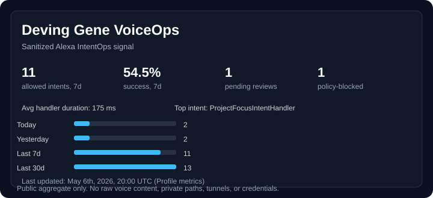
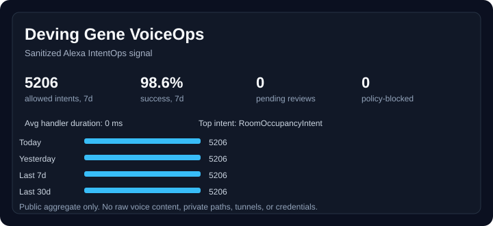
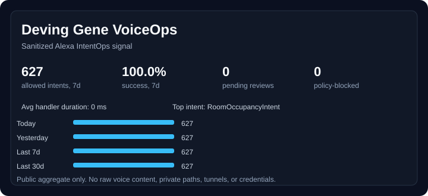

  

  

  

  
  
  
  

  <b>Featured Projects</b> 
  

  <b>Languages</b> 
  
  
  
  
  
  

  <b>Platforms & Tooling</b> 
  
  
  
  
  
  

  <b>Analysis Stack</b> 
  
  
  
  
  

  🌓 Building systems that balance creativity, reliability, data quality, and human-centered AI.

---

## Yooo, I'm Rob ☯ 👋

I'm a self-directed game programmer, software developer, and independent longevity research enthusiast with a B.S. in Information Technology and 8+ years of experience building software systems. My work spans custom Luau game-engine architecture, AI-assisted development, genomic imputation tooling, and evidence-preserving digital archives.

### About My Work

I build systems that turn complicated information into outputs people can inspect, understand, and use:

- **Game programming:** custom Roblox / Luau systems, cinematic interfaces, and interactive experiences.
- **Research software:** genomic data processing, reproducible imputation, and cautious longevity-variant interpretation.
- **Digital archival preservation:** computational genealogy, source provenance, and historical evidence validation.
- **Human-centered AI:** local-first applications, agentic automation, neurodivergent-aware computing, and experimental physiological feedback.

Generating a Roblox cinematic comparison, evaluating SNP-array evidence, and preserving a historical record all call for the same engineering habits: modularity, validation, reproducibility, and careful state management. I like building the bridge between a complex process and a result someone else can verify.

I am especially interested in:

- 🧬 **Longevity genetics:** reference-panel evaluation, genotype uncertainty, and the evidence behind population-level associations.
- 🌍 **Familial longevity research:** centenarian descendants and underrepresented ancestral populations, with attention to what the data can actually support.
- 🤖 **Agentic AI:** literature review and archival validation that retain traceable sources and human review.
- 🎮 **Interactive systems:** Luau game engines, procedural experiences, and performant cinematic UI.
- 🧠 **Adaptive interfaces:** consent-first physiological feedback and software that supports different cognitive profiles.

### 🧠 Current Focus & Research Interests

I'm developing reproducible genomic imputation and longevity-evidence workflows through **[AncestryDNA Longevity Imputator](https://github.com/RobGonWin/ancestrydna-longevity-imputator)**, alongside the **[National Heritage Fellow Longevity Archiver](https://github.com/RobGonWin/national-heritage-fellow-longevity-archiver)** and **[Ancestry Archival Validation Expediter (AAVE)](https://github.com/RobGonWin/ancestry-archival-validation-expediter)**. In parallel, I continue building **1v1 Edit Arena** and **[Deving Gene](https://github.com/RobGonWin/deving-gene)**, exploring how complex interactive systems can remain maintainable and how AI can support focus without taking away user control.

My current genomics work distinguishes observed SNP-array calls, imputed genotypes, and research hypotheses. Whole-genome and whole-exome sequencing (WGS/WES), rare and regulatory variant prioritization, and multi-omics comparisons are future research directions. Physiological telemetry and adaptive feedback interfaces also remain areas of investigation.

### 🧬 Why Longevity Research Is Personal

My interest in computational longevity research is rooted in family history. My paternal great-grandfather, **[Elder Roma Wilson](https://www.arts.gov/honors/heritage/elder-roma-wilson)**, was a semi-supercentenarian **1994 National Heritage Fellow** who lived to 107. My extended family tree also includes my great aunt-in-law, **[Bettie Rutherford Wilson](https://longeviquest.com/supercentenarian/bettie-wilson/)**, a validated supercentenarian connected through marriage, whose documented exceptional longevity adds another dimension to my family-history research. Elder Roma Wilson's legacy inspired my efforts to connect genomic evidence, genealogical records, and historical preservation through reproducible software.

I sometimes describe this intersection as **Singu-centitarian** — my own term for the meeting point of technological-era computing, centenarian heritage, and the preservation of knowledge across generations.

Through my [AncestryDNA Longevity Imputator](https://github.com/RobGonWin/ancestrydna-longevity-imputator) and [National Heritage Fellow Longevity Archive](https://github.com/RobGonWin/national-heritage-fellow-longevity-archiver), I'm developing a bridge between **archival longevity validation and computational genomics**, progressing from consumer SNP-array analysis and reference-panel-based imputation toward future privacy-conscious WGS, AI-assisted prioritization of rare and regulatory variants, and comparative investigation of familial centenarian and supercentenarian datasets. I'm especially interested in how underrepresented ancestral populations, longevity-associated genetic variation, and eventually multi-omics evidence might reveal overlooked research questions.

Family history motivates these questions; it does not establish inherited protective variants or predict lifespan. My archive is independent of the NEA, and comparisons remain bounded by their sources and validation assumptions. The [National Archives fellowship record](https://catalog.archives.gov/id/23902669) is part of the historical source chain.

## 🚧 Featured Work

<table>
  <tr>
    <td width="50%" valign="top">
      <h3>🧬 <a href="https://github.com/RobGonWin/ancestrydna-longevity-imputator">AncestryDNA Longevity Imputator</a></h3>
      
Evidence-preserving research toolkit converting AncestryDNA SNP-array data into validated GRCh37 VCF and reproducible imputation workflows. Compares reference panels and imputation sources, curates longevity-variant evidence, and tracks provenance and uncertainty with public/private data separation.

      
<b>Methods:</b> Python, VCF validation, local Beagle imputation, reference-panel comparisons

      <a href="https://github.com/RobGonWin/ancestrydna-longevity-imputator"><b>View Repository ➔</b></a>
    </td>
    <td width="50%" valign="top">
      <h3>🏛️ <a href="https://github.com/RobGonWin/national-heritage-fellow-longevity-archiver">NEA Fellow Longevity Archive</a></h3>
      
Independent archival research comparing documented longevity among National Heritage Fellows, including Elder Roma Wilson. Uses traceable sources, source-bound age validation, distinct documented and conditional evidence, reproducible datasets, and an interactive public explorer.

      
<b>Methods:</b> Python, archival provenance, CSV / JSON datasets, static web explorer

      <a href="https://robgonwin.github.io/national-heritage-fellow-longevity-archiver/site/"><b>Explore Archive ➔</b></a>
    </td>
  </tr>
  <tr>
    <td width="50%" valign="top">
      <h3>🧠 <a href="https://github.com/RobGonWin/deving-gene">Deving Gene</a></h3>
      
A consent-first workflow system in development to support neurodivergent focus. Combines Python/FastAPI services, local dashboards, and AWS/Alexa IoT integration, with AI-assisted SSML sanitization and retrieval-augmented workflows for user-state interpretation and focus preservation.

      
<b>Stack:</b> Python, JavaScript, Alexa, GitHub Actions

      <a href="https://github.com/RobGonWin/deving-gene"><b>View Repository ➔</b></a>
    </td>
    <td width="50%" valign="top">
      <h3>🎮 <a href="https://www.roblox.com/games/14835231599/1v1-Edit-Arena">1v1 Edit Arena</a></h3>
      
A self-started Roblox experience built on custom Luau systems. EditSystemv2 / SceneCompiler work explores cinematic versus-edit generation, scripted UI effects, dynamic stat comparisons, and viewport scene projection, with careful performance and state handling. Newer UI and replication work is experimental.

      
<b>Stack:</b> Luau, Roblox Studio, custom game-engine architecture

      <a href="https://www.roblox.com/games/14835231599/1v1-Edit-Arena"><b>Play / View ➔</b></a>
    </td>
  </tr>
</table>

  

---

<!--DEVING_GENE_VOICEOPS:start-->
### Deving Gene VoiceOps Signal

  

  

  
  

| Window | Allowed intents | Success | Pending reviews | Policy-blocked | Avg latency |
| --- | ---: | ---: | ---: | ---: | ---: |
| Today | 2 | 100.0% | 0 | 0 | 160 ms |
| Yesterday | 2 | 0.0% | 0 | 0 | 230 ms |
| Last 7d | 11 | 54.5% | 1 | 1 | 175 ms |
| Last 30d | 13 | 61.5% | 1 | 1 | 173 ms |
| Last 365d | 13 | 61.5% | 1 | 1 | 173 ms |

Top allowed intents, last 7d: ProjectFocusIntentHandler (4), DayScheduleIntentHandler (2), PomodoroStatusIntentHandler (2).

#### Public Alexa Metrics Timeline

4 public batches &middot; 9808 imported allowed intents &middot; 1914 saved Alexa Metrics API requests &middot; no live API calls during README refresh.

| Batch | Window | Stage | Locale | Allowed intents | API requests | Top intent | Links |
| --- | --- | --- | --- | ---: | ---: | --- | --- |
| batch_01_2025-03-01_to_2025-05-16 | 2025-03-01 to 2025-05-16 | development | en-US | 5206 | 870 | RoomOccupancyIntent (1656) | <a href="assets/metrics/public_batches/batch_01_2025-03-01_to_2025-05-16/outputs/deving_gene_voiceops_profile.public.json">profile</a> / <a href="assets/metrics/public_batches/batch_01_2025-03-01_to_2025-05-16/outputs/alexa_metrics_v2_normalized.latest.json">latest</a> / <a href="assets/metrics/public_batches/batch_01_2025-03-01_to_2025-05-16/outputs/deving_gene_voiceops_profile_card.svg">card</a> / <a href="assets/metrics/public_batches/batch_01_2025-03-01_to_2025-05-16/outputs/deving_gene_voiceops_profile_block.md">block</a> |
| batch_02_2025-04-03_to_2025-04-30 | 2025-04-03 to 2025-04-30 | development | en-US | 3350 | 464 | RoomOccupancyIntent (724) | <a href="assets/metrics/public_batches/batch_02_2025-04-03_to_2025-04-30/outputs/deving_gene_voiceops_profile.public.json">profile</a> / <a href="assets/metrics/public_batches/batch_02_2025-04-03_to_2025-04-30/outputs/alexa_metrics_v2_normalized.latest.json">latest</a> / <a href="assets/metrics/public_batches/batch_02_2025-04-03_to_2025-04-30/outputs/deving_gene_voiceops_profile_card.svg">card</a> / <a href="assets/metrics/public_batches/batch_02_2025-04-03_to_2025-04-30/outputs/deving_gene_voiceops_profile_block.md">block</a> |
| batch_03_2025-07-01_to_2025-07-31 | 2025-07-01 to 2025-07-31 | development | en-US | 625 | 290 | RoomOccupancyIntent (248) | <a href="assets/metrics/public_batches/batch_03_2025-07-01_to_2025-07-31/outputs/deving_gene_voiceops_profile.public.json">profile</a> / <a href="assets/metrics/public_batches/batch_03_2025-07-01_to_2025-07-31/outputs/alexa_metrics_v2_normalized.latest.json">latest</a> / <a href="assets/metrics/public_batches/batch_03_2025-07-01_to_2025-07-31/outputs/deving_gene_voiceops_profile_card.svg">card</a> / <a href="assets/metrics/public_batches/batch_03_2025-07-01_to_2025-07-31/outputs/deving_gene_voiceops_profile_block.md">block</a> |
| batch_04_2025-08-30_to_2025-09-30 | 2025-08-30 to 2025-09-30 | development | en-US | 627 | 290 | RoomOccupancyIntent (357) | <a href="assets/metrics/public_batches/batch_04_2025-08-30_to_2025-09-30/outputs/deving_gene_voiceops_profile.public.json">profile</a> / <a href="assets/metrics/public_batches/batch_04_2025-08-30_to_2025-09-30/outputs/alexa_metrics_v2_normalized.latest.json">latest</a> / <a href="assets/metrics/public_batches/batch_04_2025-08-30_to_2025-09-30/outputs/deving_gene_voiceops_profile_card.svg">card</a> / <a href="assets/metrics/public_batches/batch_04_2025-08-30_to_2025-09-30/outputs/deving_gene_voiceops_profile_block.md">block</a> |

Batch 1 - March 1st, 2025->May 16th, 2025

- **Stage / locale:** development / en-US
- **Imported allowed intents:** 5206
- **Alexa Metrics API requests:** 870
- **Top intents:** RoomOccupancyIntent (1656), PomodoroStatusIntent (509), PCAwakeIntent (460), ReflectionIntent (430), CurrentTaskIntent (402), StartPomodoroTimerIntent (286), NextTasksIntent (218), AMAZON.YesIntent (185), ProcrastinationIntent (183), AMAZON.FallbackIntent (128)
- **Public artifacts:** <a href="assets/metrics/public_batches/batch_01_2025-03-01_to_2025-05-16/outputs/deving_gene_voiceops_profile.public.json">profile JSON</a> &middot; <a href="assets/metrics/public_batches/batch_01_2025-03-01_to_2025-05-16/outputs/alexa_metrics_v2_normalized.latest.json">latest normalized JSON</a> &middot; <a href="assets/metrics/public_batches/batch_01_2025-03-01_to_2025-05-16/outputs/alexa_metrics_v2_normalized.live.json">live normalized JSON</a> &middot; <a href="assets/metrics/public_batches/batch_01_2025-03-01_to_2025-05-16/outputs/deving_gene_voiceops_profile_card.svg">SVG card</a> &middot; <a href="assets/metrics/public_batches/batch_01_2025-03-01_to_2025-05-16/outputs/deving_gene_voiceops_profile_block.md">rendered block</a>

Batch 2 - April 3rd, 2025->April 30th, 2025

- **Stage / locale:** development / en-US
- **Imported allowed intents:** 3350
- **Alexa Metrics API requests:** 464
- **Top intents:** RoomOccupancyIntent (724), PomodoroStatusIntent (442), PCAwakeIntent (414), StartPomodoroTimerIntent (262), CurrentTaskIntent (254), ReflectionIntent (244), AMAZON.YesIntent (152), NextTasksIntent (138), CancelPomodoroIntent (98), ClearSessionIntent (98)
- **Public artifacts:** <a href="assets/metrics/public_batches/batch_02_2025-04-03_to_2025-04-30/outputs/deving_gene_voiceops_profile.public.json">profile JSON</a> &middot; <a href="assets/metrics/public_batches/batch_02_2025-04-03_to_2025-04-30/outputs/alexa_metrics_v2_normalized.latest.json">latest normalized JSON</a> &middot; <a href="assets/metrics/public_batches/batch_02_2025-04-03_to_2025-04-30/outputs/alexa_metrics_v2_normalized.live.json">live normalized JSON</a> &middot; <a href="assets/metrics/public_batches/batch_02_2025-04-03_to_2025-04-30/outputs/deving_gene_voiceops_profile_card.svg">SVG card</a> &middot; <a href="assets/metrics/public_batches/batch_02_2025-04-03_to_2025-04-30/outputs/deving_gene_voiceops_profile_block.md">rendered block</a>

Batch 3 - July 1st, 2025->July 31st, 2025

- **Stage / locale:** development / en-US
- **Imported allowed intents:** 625
- **Alexa Metrics API requests:** 290
- **Top intents:** RoomOccupancyIntent (248), ReflectionIntent (105), ProcrastinationIntent (52), CurrentTaskIntent (34), AutoStartIntent (28), AMAZON.YesIntent (21), ClearSessionIntent (21), NextTasksIntent (19), PomodoroStatusIntent (18), JumpBlockBackIntent (17)
- **Public artifacts:** <a href="assets/metrics/public_batches/batch_03_2025-07-01_to_2025-07-31/outputs/deving_gene_voiceops_profile.public.json">profile JSON</a> &middot; <a href="assets/metrics/public_batches/batch_03_2025-07-01_to_2025-07-31/outputs/alexa_metrics_v2_normalized.latest.json">latest normalized JSON</a> &middot; <a href="assets/metrics/public_batches/batch_03_2025-07-01_to_2025-07-31/outputs/alexa_metrics_v2_normalized.live.json">live normalized JSON</a> &middot; <a href="assets/metrics/public_batches/batch_03_2025-07-01_to_2025-07-31/outputs/deving_gene_voiceops_profile_card.svg">SVG card</a> &middot; <a href="assets/metrics/public_batches/batch_03_2025-07-01_to_2025-07-31/outputs/deving_gene_voiceops_profile_block.md">rendered block</a>

Batch 4 - August 30th, 2025->September 30th, 2025

- **Stage / locale:** development / en-US
- **Imported allowed intents:** 627
- **Alexa Metrics API requests:** 290
- **Top intents:** RoomOccupancyIntent (357), ReflectionIntent (91), ProcrastinationIntent (44), AutoStartIntent (19), CurrentTaskIntent (18), AMAZON.FallbackIntent (16), PomodoroStatusIntent (12), AMAZON.NoIntent (10), DayScheduleIntent (10), NextTasksIntent (10)
- **Public artifacts:** <a href="assets/metrics/public_batches/batch_04_2025-08-30_to_2025-09-30/outputs/deving_gene_voiceops_profile.public.json">profile JSON</a> &middot; <a href="assets/metrics/public_batches/batch_04_2025-08-30_to_2025-09-30/outputs/alexa_metrics_v2_normalized.latest.json">latest normalized JSON</a> &middot; <a href="assets/metrics/public_batches/batch_04_2025-08-30_to_2025-09-30/outputs/alexa_metrics_v2_normalized.live.json">live normalized JSON</a> &middot; <a href="assets/metrics/public_batches/batch_04_2025-08-30_to_2025-09-30/outputs/deving_gene_voiceops_profile_card.svg">SVG card</a> &middot; <a href="assets/metrics/public_batches/batch_04_2025-08-30_to_2025-09-30/outputs/deving_gene_voiceops_profile_block.md">rendered block</a>

Public aggregate only: no raw voice content, SSML, transcripts, private project names, local paths, tunnel URLs, tokens, credentials, or live Alexa credentials. Local export paths are published only as REDACTED_PUBLIC_EXPORT_PATH.
<!--DEVING_GENE_VOICEOPS:end-->

---

---

<!--RECENT_ACTIVITY:start-->
- Starred [google-deepmind/science-skills](https://github.com/google-deepmind/science-skills)
- Pushed 1 commit to [RobGonWin/RobGonWin](https://github.com/RobGonWin/RobGonWin)
- Pushed 1 commit to [RobGonWin/RobGonWin](https://github.com/RobGonWin/RobGonWin)
- Pushed 1 commit to [RobGonWin/ancestrydna-longevity-imputator](https://github.com/RobGonWin/ancestrydna-longevity-imputator)
- Starred [K-Dense-AI/scientific-agent-skills](https://github.com/K-Dense-AI/scientific-agent-skills)
<!--RECENT_ACTIVITY:end-->

<!--PROFILE_UPDATE:start-->

  Last auto-updated: Nov 25, 2026 · 5:36 PM EST / 22:36 UTC · Next scheduled update: Nov 26, 2026 · 8:23 AM EST / 13:23 UTC

<!--PROFILE_UPDATE:end-->
